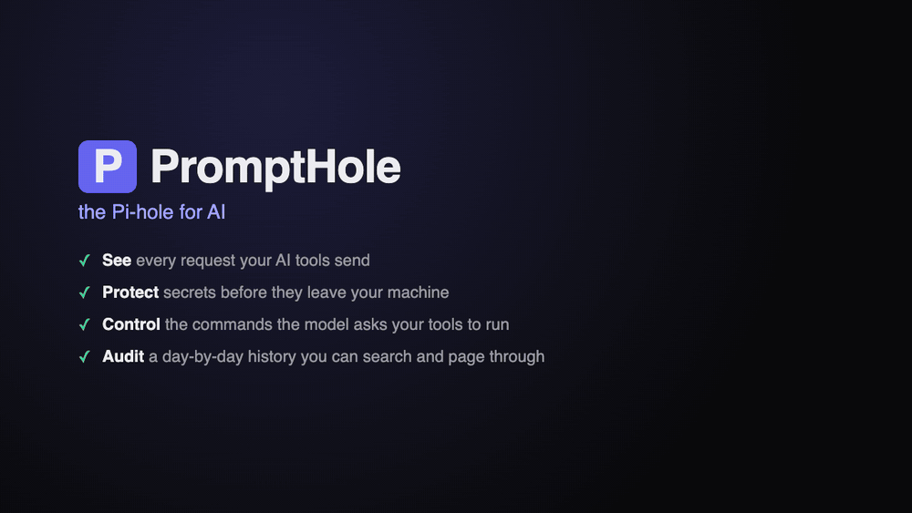

# PromptHole

**PromptHole — the Pi-hole for AI.** A gateway that shows and controls every request your tools send to AI.



<sub>The demo uses a scripted stand-in for the model so it is reproducible; the masking, blocking and command interception are PromptHole's real behaviour.</sub>

A local gateway for AI API traffic. Point your AI tools at PromptHole instead of the provider and you get:

- **See** every request: which tool sent it, to which model, how many tokens, and what matched your rules.
- **Protect** what you send: mask or block secrets and keywords *before* they leave your machine.
- **Control** what the model asks your tools to run: audit every command the model wants to execute, and block one with a single click. PromptHole swaps it for a text note, so the client never runs it.

No client-side plugins or hooks. You change one thing: the base URL.

```
Claude Code / Codex / SDK  ──►  PromptHole (127.0.0.1:8787)  ──►  Anthropic / OpenAI / Gemini / LM Studio / your company gateway
                                  │ rules, audit, dashboard
```

**If you have used Pi-hole, you will feel at home:** it is the same idea for AI. One gateway on your network, a dashboard that shows who is talking to what, and rules that decide what gets through.

Zero runtime dependencies. Node 22+. MIT licensed.

## Quick start

```bash
git clone <this repo> && cd prompthole
node server.mjs            # or: docker compose up -d
# open http://127.0.0.1:8787
```

Then point a tool at it (the **Setup** tab shows the exact line and has a Copy button):

```bash
export ANTHROPIC_BASE_URL=http://127.0.0.1:8787/anthropic      # Claude Code, Anthropic SDK
export OPENAI_BASE_URL=http://127.0.0.1:8787/openai/v1         # OpenAI SDK, Codex CLI
```

Your own API key is forwarded to the provider unchanged and is never stored.

## What you can do in the dashboard

| Tab | Purpose |
|---|---|
| **Overview** | Requests, tokens (cache and reasoning aware), blocked / masked counts, commands blocked, top rules, tools, models. |
| **Requests** | Every request with its action, matched rules and tokens. Click one for details. Matched text is hidden until you click Reveal. |
| **Commands** | What the model asked your tools to run, with a **Block…** button on each. Command rules (flag / block) and the on/off switch. |
| **Rules** | Your keyword / regex rules (Mask, Block, Log). Bulk-import from Gitleaks (~220 patterns) or Secrets Patterns DB, paste a keyword list, or import a `.env`. |
| **Clients** | How PromptHole recognises which tool sent a request. Editable, first match wins. |
| **Setup** | Upstreams (provider URL, error format, the line to configure your tool). Add any provider from the UI. |

### Content rules: Mask, Block, Log

- **Mask** replaces the match with a placeholder such as `[PROMPTHOLE_AWSKEY_1a5d44]` *before sending*. It is one-way: PromptHole does not restore the original in responses.
- **Block** rejects the request locally with a provider-shaped error (so the SDK shows a normal error).
- **Log** only records it.

### Commands: audit first, block when you decide

PromptHole reads the tool calls in the model's response. Built-in rules only **flag** risky ones (`rm -r`, `curl | sh`, force push, `sudo`, credential files, uploading a local file). Nothing is blocked until you click **Block…** on a command and choose how to match it (exact, starts with, contains, regex). The next time the model asks for it, PromptHole replaces the tool call with a text note (`⛔ PromptHole blocked this tool call … It was NOT executed`) and corrects the stop reason, so the client carries on without running it.

Command text is masked with your content rules before it is stored or matched, so secrets never reach the audit log.

Supported for inspection: Anthropic Messages and OpenAI Chat Completions, streaming and non-streaming. Anything else passes through untouched.

## Configuration

Everything is editable in the UI and stored as JSON in the data directory (files are `0600`).

| Env var | Default | |
|---|---|---|
| `PROMPTHOLE_PORT` | `8787` | Listen port |
| `PROMPTHOLE_DATA` | `./data` | Where rules, settings and the event log live |
| `PROMPTHOLE_HOST` | `127.0.0.1` | Only change inside a container (see Docker) |

### Keeping up with new tool versions

You should not need a code change for a new client version:

- **Recognising a tool:** *Clients* tab. "Recently seen" lists the user-agents PromptHole has met; click **Create rule** to turn one into a client.
- **A new provider or gateway:** *Setup* tab → add a name, a prefix, the upstream URL and the error format (`openai`, `anthropic` or `gemini`).
- **New risky commands:** *Commands* tab → add a rule, or import more content rules in *Rules*.

## Docker

```bash
docker compose up -d      # dashboard on http://127.0.0.1:8787, data in the "prompthole-data" volume
```

The compose file publishes the port to **127.0.0.1 only**. Do not publish it on all interfaces: PromptHole has no login, the loopback binding is its access control. To reach LM Studio / Ollama on your machine, set the upstream URL to `http://host.docker.internal:1234`.

## Security model

- Binds to `127.0.0.1` only; the dashboard and API reject foreign `Host` headers (DNS-rebinding) and cross-origin writes.
- Strict CSP on the dashboard; no remote assets.
- Credentials are forwarded, never stored; request bodies are never stored, only rule names, a masked sample and (optionally) the matched text, which you can switch off and purge.
- Data files are owner-readable only.

Report vulnerabilities as described in [SECURITY.md](SECURITY.md).

## Limitations (please read)

- **Not a sandbox.** PromptHole sees the model's *request* to run a command. It cannot stop a tool that runs things on its own, or an agent that was not pointed at PromptHole.
- **Only traffic through the base URL.** Web apps and desktop apps that ignore a custom URL are out of scope.
- **Tool-call inspection** covers Anthropic Messages and OpenAI Chat Completions today. OpenAI Responses and Gemini are not inspected yet.
- Compressed (`content-encoding`) request bodies are not scanned.
- Pattern matching can be evaded by encoding (base64, splitting a value across messages). Treat it as a safety net for accidents, not a barrier against a determined attacker.
- Imported Go-regex rules are converted to JavaScript; a few are marked *adapted* because case-insensitivity can only be applied to the whole pattern.

## Roadmap

PromptHole works today as a single-user gateway. The goal is a **shared gateway for teams and companies**: authentication,
per-person identity, central log export and a deployment guide are not built yet. See [ROADMAP.md](ROADMAP.md); contributions are very welcome.

## Development

```bash
npm install            # dev dependencies only (official SDKs used in tests)
npm test               # unit + integration + real-SDK tests, no network needed
npm run test:coverage
```

Layout: `server.mjs` (entry) · `src/` (config, store, http, proxy, api, static) · `lib/` (pure logic: rules, parsing, tool calls) · `public/` (dashboard ES modules) · `test/`.

See [CONTRIBUTING.md](CONTRIBUTING.md). Third-party notices: [THIRD_PARTY.md](THIRD_PARTY.md). License: [MIT](LICENSE).
